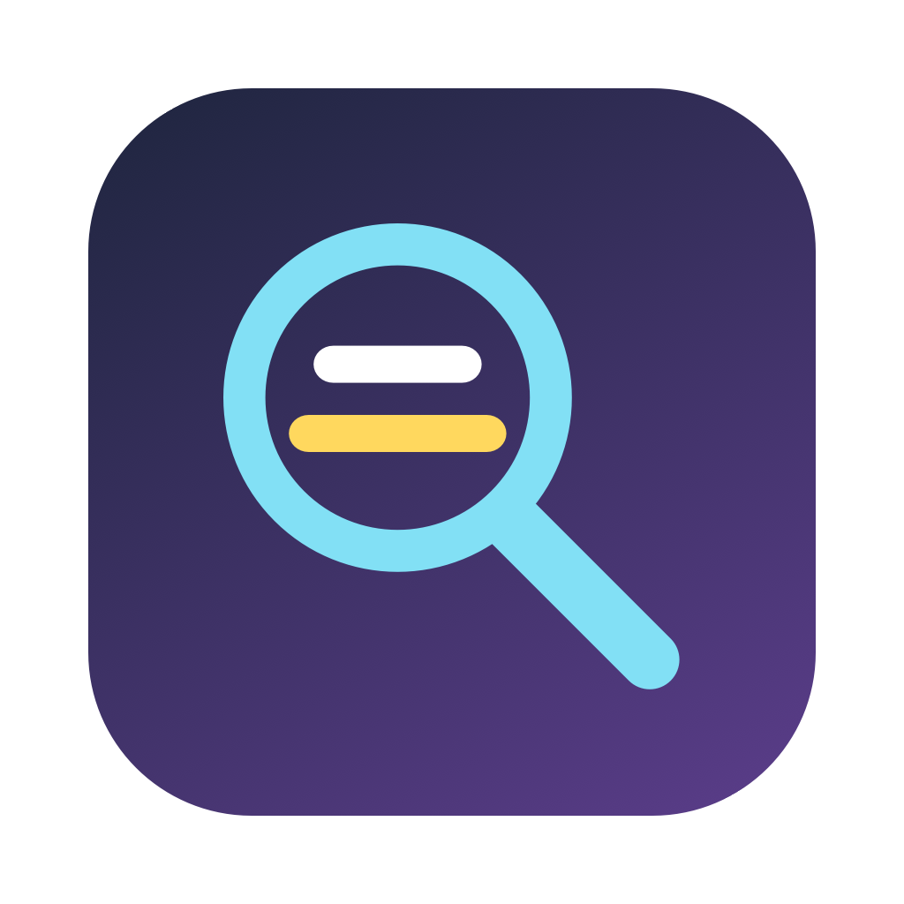
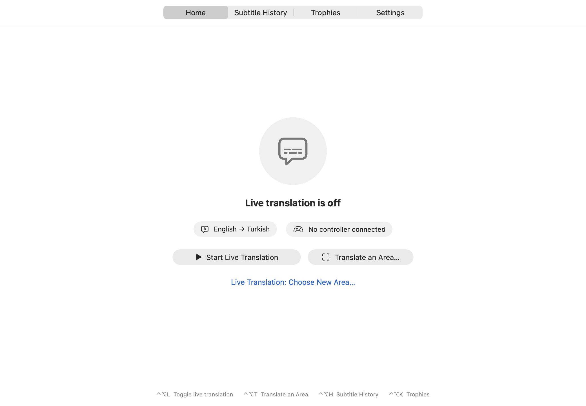
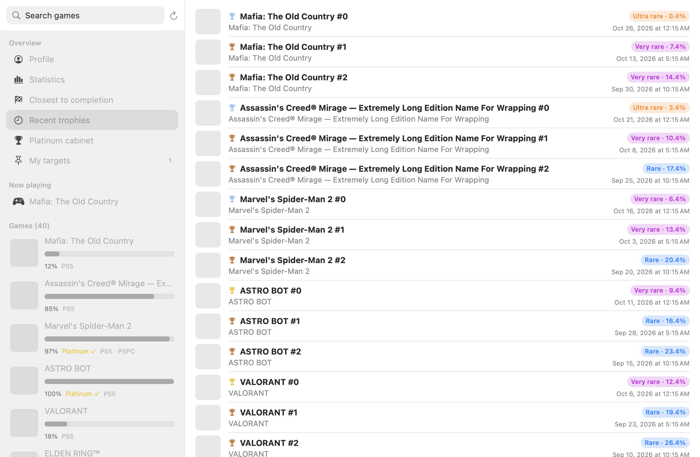

<h1 align="center">SubLens</h1>

<b>Your language, in every game.</b> Live subtitle translation for PS Remote Play on Mac — 20+ languages, plus a trophy hub for hunters.

  <a href="../../releases/latest">Download</a> ·
  <a href="https://rumpony.github.io/SubLens/">Website</a> ·
  <a href="#türkçe">Türkçe</a>

---

SubLens sits in your menu bar. Point it at the subtitle area of a game streamed with **PS Remote Play**, and every new line is read and translated on your Mac, right over the original — usually in well under a second. Nothing is sent to the cloud.

## Features

- **Live subtitles** — choose the area once; SubLens remembers it and starts when Remote Play opens (it asks first).
- **Smart reading** — skips button prompts (“PRESS R3 to CROUCH”), HUD text and system notifications; keeps speaker names (“ENZO:”) untranslated and highlighted.
- **Any text on screen** — translate a letter, a menu or an item description with one shortcut.
- **Subtitle history** — missed a line? Read it again.
- **Trophies** — your PSN trophies with rarity, a profile summary, statistics, closest-to-platinum, pinned goals with notes and one-click guide links.
- **Controller** — DualSense battery in the menu bar and a warning when it runs low.
- **20+ languages** — everything Apple's on-device recognition and translation support.
- **Interface in** English, Türkçe, Deutsch, Español, Français.

 

## For trophy hunters

If you live on PSNProfiles and PowerPyx, SubLens brings that view to your Mac: rarity on every trophy, streaks and milestones, closest-to-platinum, a platinum cabinet, pinned goals with notes, and one click to the game's PSNProfiles, PowerPyx and YouTube guides. *(Not affiliated with either site.)*

## Requirements

- Mac with Apple silicon, **macOS 26** or later
- [PS Remote Play](https://remoteplay.dl.playstation.net/remoteplay/lang/en/index.html) (works with any video with subtitles, too)

## Install

1. Download `SubLens.zip` from the [latest release](../../releases/latest) and move **SubLens** to Applications.
2. The app isn't notarized yet, so open it the first time with **right-click → Open**.
3. Allow **Screen Recording** when asked (System Settings → Privacy & Security).
4. Open the app from the menu bar, then **Settings → Download Language Pack**.

| Shortcut | Action |
|---|---|
| ⌃⌥L | Live translation on/off |
| ⌃⌥T | Translate an area |
| ⌃⌥H | Subtitle history |
| ⌃⌥K | Trophies |

## Privacy

- Screen reading and translation run **on your Mac** with Apple frameworks. No subtitles, screenshots or analytics leave your computer.
- Trophies are optional. Signing in happens on Sony's own page; SubLens stores only the resulting session token, in a file only your user account can read, and only reads data.

## How it works

| Part | Technology |
|---|---|
| Capture | ScreenCaptureKit (own windows excluded) |
| Text recognition | Vision `RecognizeTextRequest` (accurate) |
| Translation | Apple Translation framework, on-device |
| Interface | SwiftUI + AppKit, menu bar app |
| Trophies | PlayStation Network mobile endpoints (read-only, rate-limited) |
| Build | XcodeGen + GitHub Actions |

Build it yourself: `brew install xcodegen && xcodegen generate && open SubLens.xcodeproj`.
UI previews and layout checks with mock data: `Tools/Preview/run.sh /tmp/preview tr,en`.

## Disclaimer

SubLens is an independent project. It is not affiliated with, endorsed or sponsored by Sony Interactive Entertainment. “PlayStation”, “PS5” and “PS Remote Play” are trademarks of Sony Interactive Entertainment Inc. Trophy features use unofficial endpoints and may stop working at any time.

## License

[MIT](LICENSE)

---

## Türkçe

**Türkçe altyazısı olmayan oyunlara Türkçe altyazı.** SubLens, Mac'te PS Remote Play ile oynarken oyun altyazılarını canlı olarak Türkçeye (ve 20'den fazla dile) çevirir. Altyazı alanını bir kez seçersin; SubLens her yeni satırı okur, genelde bir saniyenin altında çevirip orijinalin üstüne yazar. Her şey Mac'inde çalışır, hiçbir şey buluta gitmez.

- Tuş ipuçlarını ve ekran yazılarını atlar, karakter adlarını çevirmeden renkli gösterir.
- Mektup, menü, eşya açıklaması gibi her yazıyı tek kısayolla çevirir.
- Kaçırdığın satırları altyazı geçmişinden okursun.
- PSN kupaların: nadirlik, istatistikler, platine en yakın oyunlar, notlu hedefler, rehber linkleri.
- DualSense pil uyarısı, 20+ dil, Türkçe arayüz.

Kurulum: [son sürümü](../../releases/latest) indir, Uygulamalar'a taşı, ilk açılışta **sağ tık → Aç**, ekran kaydı iznini ver.
